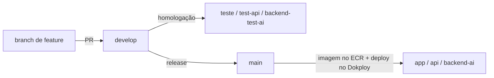

## Domínios

| Software | Produção | Homologação |
| --- | --- | --- |
| Web app (`frontend-miggo`) | `app.miggomkt.com.br` | `teste.miggomkt.com.br` |
| Plataforma (`backend-miggo`) | `api.miggomkt.com.br` | `test-api.miggomkt.com.br` |
| MiggoAI (`miggoai_v2`) | `backend-ai.miggomkt.com.br` | `backend-test-ai.miggomkt.com.br` |

Outros domínios que aparecem no código:

- `plataforma.miggomkt.com.br` — domínio anterior do Web app, ainda reconhecido como host da Miggo (`HOSTS_PLATAFORMA` em `core/settings.py`).
- `<slug>.<PLATFORM_BASE_DOMAIN>` e domínios próprios cadastrados por agências — servidos pelo mesmo Web app; veja [Agências](/plataforma/apps/agencia).
- `test-ai.miggomkt.com.br` — front antigo do MiggoAI em homologação. Não é a API: a API de homologação é `backend-test-ai.miggomkt.com.br`.
- `ajuda.miggomkt.com.br` — central de ajuda, para clientes.

<Note>
  Em desenvolvimento os três rodam na máquina: Plataforma em `localhost:8000`, MiggoAI em `localhost:8010` e Web app em `localhost:5173`. Veja o [Quickstart](/quickstart).
</Note>

## O que separa os ambientes

Homologação é uma cópia completa: banco próprio para cada serviço, mesmas imagens e outra configuração. Um ambiente nunca fala com o outro; quando isso acontece, é variável errada.

| Variável | Software | Regra |
| --- | --- | --- |
| `DB_NAME`, `DB_USER`, `DB_PASSWORD`, `DB_HOST`, `DB_PORT` | Plataforma e MiggoAI | Banco separado por ambiente. |
| `FRONTEND_URL` | Plataforma | URL do Web app do **mesmo** ambiente. O default é `https://app.miggomkt.com.br`: sem a variável, homologação monta links para produção. |
| `BACKEND_URL` | Plataforma | URL pública da própria API, usada em links gerados fora de um request (mídia pelo WhatsApp, rastreio de clique do e-mail). |
| `MIGGOAI_V2_API_URL`, `MIGGOAI_V2_API_KEY` | Plataforma | Apontam para o MiggoAI do mesmo ambiente. |
| `MIGGO_API_BASE_URL`, `MIGGO_API_KEY` | MiggoAI | Apontam para a Plataforma do mesmo ambiente. |
| `JWT_PRIVATE_KEY` / `MIGGO_JWT_PUBLIC_KEY` | Plataforma / MiggoAI | Par de chaves por ambiente: o MiggoAI só aceita o token da Plataforma do seu ambiente. |
| `STRIPE_API_KEY` (ou `STRIPE_PROD_API_KEY`), `STRIPE_WEBHOOK_SECRET` | Plataforma | Chave do modo de teste da Stripe em homologação; o segredo do webhook casa com o endpoint cadastrado na Stripe para aquele ambiente. |
| `LATE_API_KEY` | Plataforma | Publica de verdade nas redes do cliente: em homologação, não use a chave de produção. |
| `OPENAI_API_KEY` | Plataforma e MiggoAI | Chave separada por ambiente, para os custos não se misturarem. |
| `EMAIL_HOST_USER`, `EMAIL_HOST_PASSWORD` | Plataforma | E-mail de homologação não pode chegar à caixa de cliente. |
| `VITE_API_BASE_URL`, `VITE_MIGGOAI_API_URL` | Web app | Endereço da Plataforma e do MiggoAI do mesmo ambiente. Tudo em `VITE_*` é público. |

A lista completa de variáveis está em [Variáveis da Plataforma](/plataforma/configuracao), [Variáveis do MiggoAI](/miggoai/configuracao) e [Rodar o Web app](/web/rodar-localmente).

## Hospedagem

Os três softwares rodam em containers gerenciados pelo **Dokploy**. Cada repo tem o workflow `.github/workflows/docker-ecr.yml`, que no push da `main` constrói a imagem e publica no **Amazon ECR** com as tags `:<sha>` e `:latest`. A `develop` não gera imagem. A atualização do container no Dokploy é manual.

A Plataforma e o MiggoAI usam a mesma imagem para a API e para o worker de fila: a variável `ROLE` (`web` ou `worker`) decide o que o container sobe. Veja [Deploy da Plataforma](/plataforma/deploy), [Deploy do MiggoAI](/miggoai/deploy) e [Build e deploy do Web app](/web/build-e-deploy).

## Caminho de uma mudança

1. Toda mudança nasce numa branch a partir da `develop` e entra por pull request.
2. A `develop` é o que roda em homologação.
3. A release leva para a `main` as mudanças validadas em homologação; o push da `main` gera as imagens.
4. O deploy em produção atualiza os containers no Dokploy. As releases ficam registradas no [Changelog](/releases).

<Warning>
  Mudança de contrato entre os serviços (campo, rota, formato de token) precisa chegar aos dois lados na mesma release. A ordem segura é: a Plataforma primeiro, depois o MiggoAI e o Web app.
</Warning>
