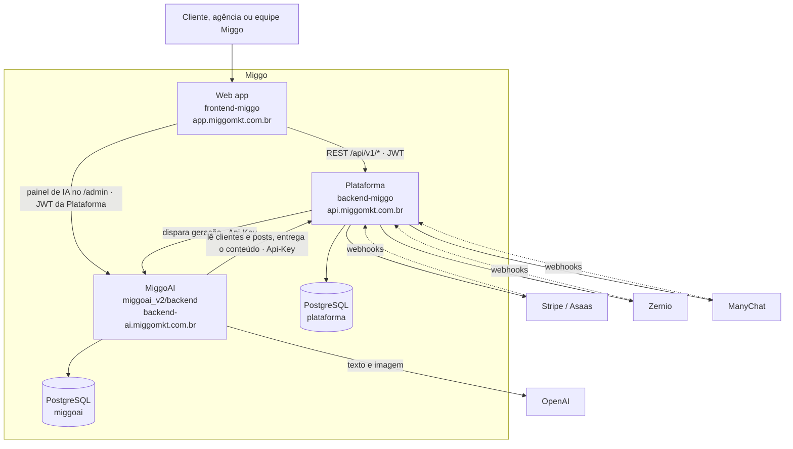

A Miggo é feita de três aplicações independentes, cada uma no seu repositório, que conversam por HTTP.

## Responsabilidade de cada software

<Columns cols={3}>
  <Card title="Plataforma" icon="server" href="/plataforma/rodar-localmente">
    Fonte da verdade do domínio: contas, agências, clientes, marcas, posts, calendário editorial, mídia, assinaturas e conversas. Emite o JWT, recebe os webhooks dos provedores e dispara a geração no MiggoAI.
  </Card>
  <Card title="Web app" icon="monitor" href="/web/rodar-localmente">
    Única interface do produto, sem banco próprio. Áreas por papel: `/app` para o cliente, área da agência e `/admin` para a equipe Miggo, onde fica o [painel de IA](/web/painel-de-ia).
  </Card>
  <Card title="MiggoAI" icon="sparkles" href="/miggoai/arquitetura">
    Serviço de geração por IA. Mantém prompts versionados e os workflows que produzem grid, título, imagem, legenda e hashtags, e registra o custo de cada chamada.
  </Card>
</Columns>

## Contratos entre os serviços

| De → para | Como autentica | Para quê | Onde ler |
| --- | --- | --- | --- |
| Web app → Plataforma | `Authorization: Bearer <access>` (JWT RS256 emitido em `POST /api/v1/account/token/`) | toda a API `/api/v1/*` | [Autenticação na Plataforma](/plataforma/autenticacao) |
| Web app → MiggoAI | o mesmo JWT da Plataforma | painel de IA: prompts, execuções, custos, geração manual | [Painel de IA](/web/painel-de-ia) |
| Plataforma → MiggoAI | `Authorization: Api-Key <MIGGOAI_V2_API_KEY>` | grid do onboarding, gerar agora, gerar card, regenerar item, peças de perfil | [Integração com a Plataforma](/miggoai/integracao-com-a-plataforma) |
| MiggoAI → Plataforma | `Authorization: Api-Key <MIGGO_API_KEY>` | ler clientes, calendário e posts; entregar mídia e conteúdo | [Integração com a Plataforma](/miggoai/integracao-com-a-plataforma) |
| Provedores → Plataforma | assinatura ou token por provedor | cobrança, publicação, conexão de contas, WhatsApp | [Webhooks](/plataforma/guias/webhooks) |

Toda chamada da Plataforma a um serviço externo, MiggoAI incluído, é registrada na tabela `Integration` (app [`integration`](/plataforma/apps/integration)). O registro é *best-effort*: falhar ao auditar nunca derruba o fluxo.

## API da Plataforma

Os recursos ficam sob `/api/v1/`, um prefixo por app Django (`/api/v1/account/`, `/api/v1/client/`, `/api/v1/agency/`, `/api/v1/post/`…). Os webhooks ficam fora do prefixo, em `/webhooks/`. A lista completa de endpoints, agrupada por recurso, está na [Referência de API da Plataforma](/plataforma/api-referencia); o mapa de apps está em [Estrutura da Plataforma](/plataforma/estrutura).

## Próximos passos

<Columns cols={2}>
  <Card title="Fluxos principais" icon="git-branch" href="/arquitetura/fluxos">
    Onboarding, geração, aprovação, publicação e cobrança, ponta a ponta.
  </Card>
  <Card title="Integrações externas" icon="plug" href="/arquitetura/integracoes-externas">
    O papel de cada provedor e onde o código de integração vive.
  </Card>
</Columns>
