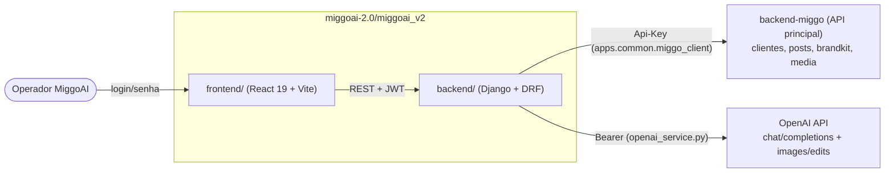
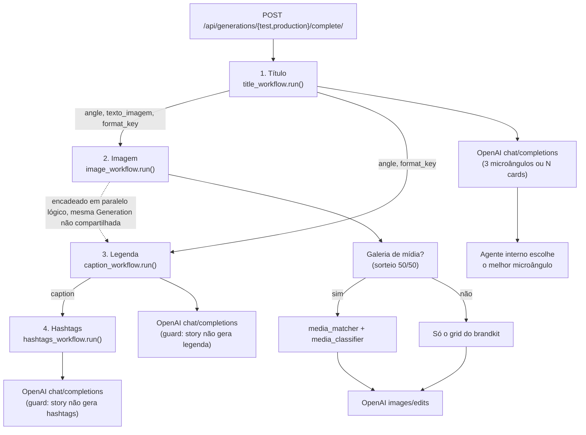

## Visão geral

O MiggoAI é um **serviço interno auxiliar** ao `backend-miggo` (a plataforma principal da Miggo). Ele não tem modelo próprio de clientes/posts — consome esses dados ao vivo, via HTTP, direto do `backend-miggo`, e devolve conteúdo gerado por IA (título, imagem, legenda, hashtags) — aplicado ao post pelo operador (painel) ou entregue automaticamente pela geração diária (`generate_daily_contents`, ver [Workflows](/miggoai/workflows)).



- **`frontend/`** fala apenas com o **backend do próprio MiggoAI** (`VITE_API_BASE_URL`), autenticado via JWT (SimpleJWT). Nunca chama o `backend-miggo` ou a OpenAI diretamente.
- **`backend/`** fala com o `backend-miggo` (autenticado por API Key, header `Authorization: Api-Key <chave>`, ver `apps/common/miggo_client.py:19-23`) e com a OpenAI (autenticado por Bearer token, `apps/generations/services/openai_service.py:55-59`).
- Não existe sincronização/cache de clientes ou posts no MiggoAI — cada geração busca os dados ao vivo (exceto o histórico de posts do dia, cacheado em `ClientPostHistory` — ver abaixo).

## Relação com os dados do backend-miggo

Os únicos dados que o `backend-miggo` expõe e o MiggoAI consome:

| Recurso (backend-miggo) | Endpoint consumido | Módulo/serviço MiggoAI |
|---|---|---|
| Clientes | `client/list/` | `apps.clients.services.list_clients` / `get_client_detail` |
| Briefing (client-meta) | `client/client-meta/list/` | `apps.clients.services.get_briefing` |
| Grid 3x3 (brandkit) | `brandkit/grid/list/` | `apps.clients.services.get_client_grid` |
| Logo (brandkit) | `brandkit/list/`, `brandkit/logo/list/` | `apps.clients.services.get_client_logo` |
| Galeria de mídia | `media/list/` | `apps.clients.services.get_client_media_library` |
| Preferência de assinatura | `client/signature-preference/<id>/` | `apps.clients.services.get_signature_preference` |
| Posts (cards) | `post/list/`, `post/detail/<id>/` | `apps.posts.services.list_posts` / `get_post_detail` |
| Formatos de post | `post/format/list/` | `apps.posts.services.get_post_formats` |
| Status de post | `post/status/list/` | `apps.posts.services.get_post_statuses` |
| Clientes com workflow ligado | `client/list/?miggoai_workflow_enabled=true` | `apps.clients.services.list_workflow_enabled_clients` |
| Predefinição de foto real | `client/media-preference/<id>/` | `apps.clients.services.get_client_media_preference` (`usage`, `reuse_days`, `use_stock`) |
| Banco de imagens elegível | `media/acervo/elegiveis/?client_id=&fadiga=1` | `apps.clients.services.get_acervo_elegiveis` — header `Acervo-Service-Token`, não a `MIGGO_API_KEY` (MIG-457) |

**Escrita** — a geração diária escreve no `backend-miggo` (`apps/generations/services/delivery.py`, via `miggo_client.post`/`patch`); a exceção é o registro de uso do banco, feito pelo `runner` ao concluir qualquer geração de imagem (`post_acervo`):

| Ação | Endpoint |
|---|---|
| Registrar uso de foto do banco | `POST media/acervo/uso/` — `apps.clients.services.registrar_uso_do_acervo`, com o token do acervo (MIG-457) |
| Subir imagem gerada | `POST media/create/` (multipart) |
| Ligar imagem ao card | `POST post/media-post/create/` |
| Reservar / devolver / concluir card | `PATCH post/update/<id>/` (`processing` → `pending` ou `scheduled`, com título/legenda/formato) |

O único dado do `backend-miggo` que o MiggoAI **persiste** localmente é um retrato diário do histórico de posts (`ClientPostHistory`, um registro por cliente/dia — `apps/clients/models.py:26-51`), para não repetir 3 chamadas HTTP a cada geração do mesmo dia. Respostas de variáveis de prompt fornecidas manualmente pelo operador também ficam salvas localmente (`ClientVariableValue`), reaproveitadas nas próximas gerações do mesmo cliente.

## Árvore de diretórios comentada

```text
miggoai-2.0/miggoai_v2/
├── backend/                        # API Django/DRF em produção
│   ├── core/                       # settings, urls, wsgi/asgi
│   ├── apps/
│   │   ├── clients/                # proxy de clientes + ClientVariableValue/ClientPostHistory
│   │   ├── posts/                  # proxy de posts/formatos/status
│   │   ├── prompts/                # CMS de prompts (Workflow, PromptDefinition, versões, variáveis)
│   │   ├── generations/            # execução dos workflows de IA + Generation (auditoria)
│   │   │   └── services/
│   │   │       ├── runner.py           # ponto único de execução (cria/fecha a Generation)
│   │   │       ├── context_builder.py  # monta o contexto (cliente/post/histórico/calendário)
│   │   │       ├── output_contract.py  # schema JSON + instrução fixa por tipo de saída
│   │   │       ├── openai_service.py   # cliente OpenAI (chat + geração de imagem)
│   │   │       ├── title_workflow.py, image_workflow.py, caption_workflow.py, hashtags_workflow.py
│   │   │       ├── media_matcher.py    # peneira léxica da galeria de mídia
│   │   │       └── media_classifier.py # julgamento por IA de qual foto usar
│   │   ├── custos/                 # auditoria de tokens, custos de IA e cotação USD/BRL (MIG-411, MIG-468)
│   │   │   ├── models.py           # ChamadaIA, PrecoModelo, CotacaoDolar
│   │   │   ├── services/           # agregados (custo_por_geracao, bloco_custo) e cambio (taxa_vigente)
│   │   │   └── management/commands # atualizar_cotacao (cron), seed_precos
│   │   └── common/                 # apps.common.miggo_client — cliente HTTP base para o backend-miggo
│   └── manage.py
├── frontend/                       # SPA React 19 + Vite (painel do MiggoAI)
│   └── src/{pages,components,context,services,types}
├── modules/                        # PROTÓTIPO original dos workflows (histórico, ver nota abaixo)
│   ├── miggo.py                    # 1ª versão do cliente HTTP do backend-miggo
│   ├── openai.py                   # 1ª versão do cliente OpenAI
│   └── workflow.py                 # 1ª versão dos workflows encadeados
├── main.py                         # CLI interativa que roda modules/workflow.py
├── requirements.txt                # deps só de modules/ e main.py (requests, Pillow, python-dotenv)
├── Dockerfile.backend / Dockerfile.frontend
└── docs internos (.env.example, etc.)
```

<Warning>
  `modules/` e `main.py` são o **protótipo** que validou o fluxo de geração antes de ele ser portado para dentro do
  Django (`backend/apps/generations/services/`). O código é muito parecido propositalmente — comentários no próprio
  backend citam isso (`backend/apps/generations/services/openai_service.py:1-5`: "porte direto da lógica já validada
  em `modules/openai.py`"). Hoje a versão que roda em produção/no frontend é a do `backend/`; `modules/`+`main.py`
  seguem funcionais mas são standalone (não usam Django, não persistem `Generation`, não passam pelo CMS de prompts).
</Warning>

## Polling e custos de geração

A tela de Gerações (`frontend/src/pages/Geracoes.tsx`) monitora execuções e gerações com **polling a cada 5 s** (só a página 1, mesclada à lista já carregada) e rolagem infinita, com otimizações para não onerar o servidor:

- **Paginação direto no banco**: `GET /api/generations/linhas/` realiza a união de execuções (`Execucao`) e gerações avulsas (`Generation`) via `UNION` ordenada direto no SQL (`values_list('tipo', 'id', 'created_at')` das duas consultas, `union(all=True)`, `order_by('-created_at', 'tipo', '-id')[start:start + page_size]`), com teto estrito de `page_size <= 200` (`PAGE_SIZE_MAX`). Antes da MIG-468 todos os registros eram carregados e ordenados em Python a cada chamada.
- **Leitura de câmbio sem rede**: para converter valores em dólares para reais nas linhas da listagem, o endpoint usa `cambio.taxa_vigente()`, que lê apenas a última cotação já gravada na tabela `CotacaoDolar`. A busca em fontes externas (AwesomeAPI, com fallback no SGS do Banco Central) fica no cron `atualizar_cotacao --forcar` (`cambio.cotacao_do_dia(forcar=True)`) ou, sem cron, na primeira leitura do dia que precisar dela; a tela de Gerações nunca dispara essa busca durante o polling.
- **Sensibilidade de visibilidade**: o tick é ignorado com a aba oculta (`document.visibilityState !== "visible"`) e dispara na hora quando ela volta a ficar visível (`visibilitychange`); um tick não empilha sobre outra chamada ainda em voo.
- **Rolagem infinita**: a tela pede páginas de 30 (`PAGE_SIZE`) e, ao chegar ao fim da lista, busca a seguinte e acrescenta sem duplicar (chave `tipo-id`). O polling mescla a página 1 por `tipo`+`id` sem perder o que a rolagem já trouxe. Troca de filtro zera a lista e volta à página 1.

## Fluxo de geração (título → imagem → legenda → hashtags)

O fluxo completo é orquestrado por `run_complete` (`backend/apps/generations/services/runner.py:167-215`), que encadeia 4 execuções independentes de `run_workflow`, cada uma virando seu próprio registro `Generation`:



Pontos-chave do encadeamento (`runner.py:167-215`):

1. **Título** roda primeiro e sempre decide o `format_key` (story/feed/carrossel/reel) — por sorteio entre os formatos sugeridos do calendário editorial, ou herdado do card se já definido manualmente (`context_builder._escolher_formato`, `backend/apps/generations/services/context_builder.py:212-248`).
2. O `format_key` e o `angle`/texto escolhidos no título são repassados como `variable_overrides` para os 3 passos seguintes — nunca persistidos como preferência do cliente (`_CHAIN_ONLY_KEYS`, `runner.py:31-40`), para não vazar o texto de um post específico para gerações futuras.
3. Se um passo falha, a cadeia para ali; os passos já concluídos continuam salvos e são devolvidos ao frontend.
4. **Imagem** não depende do texto de legenda/hashtags — roda em paralelo lógico à legenda (mesma entrada: título + formato).
5. **Hashtags** depende do texto da legenda gerada no passo 3.

Cada ambiente (`TEST`/`PRODUCTION`) grava as imagens em subpastas separadas dentro de `MEDIA_ROOT` (`imagens.pasta_da_geracao`, `backend/apps/generations/services/imagens.py:17-21`), e generations de `TEST` podem ser apagadas manualmente ou por rotina de limpeza (`cleanup_test_generations`, ver <a href="/miggoai/workflows">Workflows</a>).

Nem todo arquivo da pasta está em `image_paths`: o workflow do banner também guarda ali a arte de fundo (`arte_banner.png`), cujo caminho sai em `result.banner.arte_path` e é reaproveitado no ajuste seguinte quando o pedido não fala da arte. Quem apaga uma geração deve usar `imagens.caminhos_salvos(generation)`, que soma os dois, em vez de só `image_paths`.

<Columns cols={2}>
  <Card title="Referência de API" icon="plug" href="/miggoai/api-referencia">Todos os endpoints do backend.</Card>
  <Card title="Workflows" icon="diagram-project" href="/miggoai/workflows">Cada função de geração em detalhe.</Card>
</Columns>
