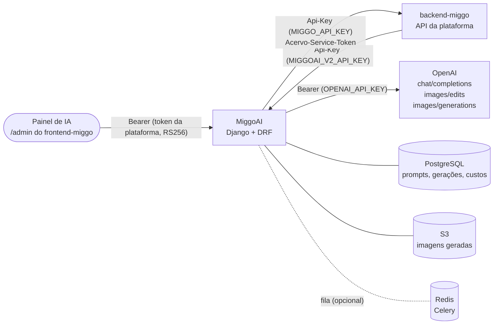

O MiggoAI é um serviço interno de geração de conteúdo. Ele não é dono de cliente nem de post: lê esses dados ao vivo do `backend-miggo`, gera o conteúdo com a OpenAI e devolve o resultado, seja na resposta (grid, bio, banner, destaques), seja entregando direto no post da Plataforma (rodada diária, gerar card, regenerar).



| Quem chama | Para quê | Credencial |
|---|---|---|
| Painel de IA (`frontend-miggo`, `/admin/miggoai`) | operar: ver execuções, gerar, editar prompts, custos e modelos | token da Plataforma |
| `backend-miggo` | acionar geração: gerar agora, gerar card, regenerar, grid e peças de perfil do onboarding | chave de serviço |
| Agendador do Dokploy | rodar `generate_daily_contents` | — (comando no container) |

Detalhes de cada credencial em [Autenticação](/miggoai/autenticacao); endpoints da Plataforma consumidos em [Integração com a Plataforma](/miggoai/integracao-com-a-plataforma).

## O que o MiggoAI guarda

| Dado | Model | Por quê |
|---|---|---|
| Prompts, variáveis, versões e config de modelo | `apps.prompts` (`Workflow`, `WorkflowConfig`, `PromptDefinition`, `PromptVersion`, `PromptVariable`) | o conteúdo dos prompts é editável sem deploy |
| Registro de cada geração e execução | `apps.generations` (`Generation`, `Execucao`) | auditoria, polling, idempotência e entrega |
| Custo de cada chamada de IA | `apps.custos` (`ChamadaIA`, `PrecoModelo`, `CotacaoDolar`) | quanto cada geração custou |
| Respostas de variáveis por cliente e retrato diário do histórico de posts | `apps.clients` (`ClientVariableValue`, `ClientPostHistory`) | reaproveitar o que o operador já respondeu; não repetir 3 chamadas HTTP por geração no mesmo dia |
| Espelho do usuário da gestão | `apps.common` (`UsuarioPlataforma`) | `created_by` aponta para um usuário local |

Cliente e post não são copiados: `apps.clients` e `apps.posts` são proxies HTTP para o `backend-miggo`. Ver [Modelo de dados](/miggoai/modelo-de-dados).

## Organização do código

```text
miggoai-2.0/miggoai_v2/backend/
├── core/                 # settings, urls, celery, fila, flower_guard, /health/
├── apps/
│   ├── common/           # miggo_client (HTTP para o backend-miggo), autenticação, permissões
│   ├── clients/          # proxy de clientes + variáveis salvas e histórico diário
│   ├── posts/            # proxy de posts, formatos e status (sem models)
│   ├── prompts/          # CMS de prompts, renderização e versionamento
│   ├── generations/      # workflows, runner, rodada diária, entrega, tasks do Celery
│   │   └── services/     # runner, context_builder, *_workflow, openai_service, delivery, rodada, locks
│   └── custos/           # registro de custo, preços, câmbio e agregados
├── docker-entrypoint.sh  # ROLE=web ou worker
└── requirements.txt
```

A interface do MiggoAI é o [painel de IA](/web/painel-de-ia) no `/admin` do `frontend-miggo`.

## Como uma geração anda

1. A entrada chega por um endpoint (`/api/generations/...`) ou pelo comando `generate_daily_contents`.
2. O `runner` cria a `Generation` como `RUNNING`, monta o contexto (`context_builder`: cliente, briefing, post, histórico, grid) e chama o workflow.
3. O workflow renderiza o prompt do CMS, anexa o contrato de saída fixo e chama a OpenAI (`openai_service`). Cada chamada grava uma `ChamadaIA` com o custo.
4. Imagens vão para o `default_storage` em `generations/<test|production>/<id>/`.
5. A `Generation` fecha como `SUCCESS` ou `FAILED`, sempre, com a trilha de auditoria.
6. Na rodada diária e no gerar card, a entrega (`delivery`) sobe as imagens e atualiza o post no `backend-miggo`.

O encadeamento título → imagem → legenda → hashtags e cada workflow estão em [Workflows](/miggoai/workflows).

## Síncrono, thread ou fila

| Fluxo | Sem fila | Com `REDIS_URL` + flag |
|---|---|---|
| Grid, bio, banner, destaques | síncrono, resultado na resposta | `202` + task; resultado por `by-key` (`GRID_ASYNC`, `PERFIL_ASYNC`) |
| Gerar agora, gerar card, regenerar | `202` + thread | `202` + task (`FILA_ASYNC`) |
| Rodada diária | sequencial no comando, lock de arquivo | uma task por cliente em `ia_lote`, lock por cliente no Redis |
| Entrega no post | dentro da rodada | task `generations.entregar` na fila `entrega` |

<Columns cols={2}>
  <Card title="Gerar conteúdo" icon="sparkles" href="/miggoai/guias/gerar-conteudo">Os fluxos de geração, passo a passo.</Card>
  <Card title="Workflows" icon="workflow" href="/miggoai/workflows">O que cada workflow faz.</Card>
</Columns>
