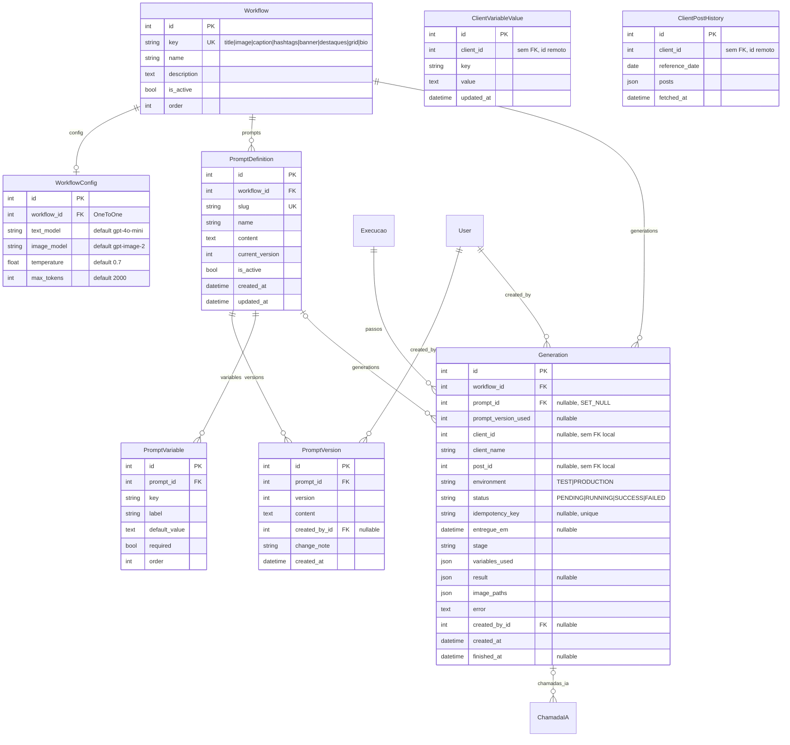

<Note>
  O MiggoAI não tem model local de `Client` nem `Post` — esses dados vivem só no `backend-miggo` e são consumidos ao
  vivo (ver [Arquitetura](/miggoai/arquitetura)). Os models abaixo cobrem apenas o que o MiggoAI persiste
  localmente: preferências de variável, retrato de histórico, prompts/workflows, o registro das gerações e os custos.
</Note>

## Diagrama

## `apps.clients`

Fonte: `backend/apps/clients/models.py`.

### `ClientVariableValue`

Resposta de uma variável de prompt já fornecida para um cliente (override manual salvo de uma geração anterior), reaproveitada automaticamente nas próximas gerações desse cliente pelo `runner`.

| Campo | Tipo | Detalhe |
|---|---|---|
| `client_id` | `PositiveIntegerField` | Indexado. Id do cliente no backend-miggo — sem FK local (o `Client` não existe como model neste projeto). |
| `key` | `CharField(60)` | Chave da variável (ex.: `tone_of_voice`). |
| `value` | `TextField` | Valor salvo, pode ser vazio. |
| `updated_at` | `DateTimeField` | `auto_now=True`. |

**Meta**: `unique_together = ('client_id', 'key')`; `ordering = ['key']`.

### `ClientPostHistory`

Retrato do histórico de posts do cliente para um dia — evita repetir 3 chamadas HTTP ao backend-miggo a cada geração do mesmo dia.

| Campo | Tipo | Detalhe |
|---|---|---|
| `client_id` | `PositiveIntegerField` | Indexado. |
| `reference_date` | `DateField` | Dia a que o retrato se refere. |
| `posts` | `JSONField` | Lista de posts, já deduplicados e ordenados (`default=list`). |
| `fetched_at` | `DateTimeField` | `auto_now_add=True`. |

**Meta**: `unique_together = ('client_id', 'reference_date')`; `ordering = ['-reference_date']`; `verbose_name_plural = 'client post histories'`.

## `apps.posts`

Sem models. O app é um proxy HTTP (`apps/posts/services.py`), sem persistência local.

## `apps.prompts`

Fonte: `backend/apps/prompts/models.py`.

### `Workflow`

Um tipo de geração de conteúdo.

| Campo | Tipo | Detalhe |
|---|---|---|
| `key` | `CharField(30)`, choices | Único. `title`, `image`, `caption`, `hashtags`, `banner`, `destaques`, `grid`, `bio` (constantes `KEY_*`). |
| `name` | `CharField(100)` | Nome de exibição. |
| `description` | `TextField` | Opcional. |
| `is_active` | `BooleanField` | Default `True`. |
| `order` | `PositiveSmallIntegerField` | Default `0`, usado para ordenação na UI. |

**Meta**: `ordering = ['order', 'id']`.

### `WorkflowConfig`

Configuração de modelo de IA por workflow.

| Campo | Tipo | Detalhe |
|---|---|---|
| `workflow` | `OneToOneField(Workflow)` | `on_delete=CASCADE`, `related_name='config'`. |
| `text_model` | `CharField(60)` | Default `'gpt-4o-mini'`. |
| `image_model` | `CharField(60)` | Default `'gpt-image-2'`. |
| `temperature` | `FloatField` | Default `0.7`. |
| `max_tokens` | `PositiveIntegerField` | Default `2000`. |

### `PromptDefinition`

Um template de prompt editável, vinculado a um `Workflow`.

| Campo | Tipo | Detalhe |
|---|---|---|
| `workflow` | `ForeignKey(Workflow)` | `on_delete=CASCADE`, `related_name='prompts'`. |
| `slug` | `SlugField(80)` | Único (ex.: `titulo-story`, `imagem-post`, `legenda-post`, `hashtags-post`). |
| `name` | `CharField(150)` | Nome de exibição. |
| `content` | `TextField` | Template com `{{variavel}}`. |
| `current_version` | `PositiveIntegerField` | Default `1`, incrementado a cada mudança de `content` via `PUT`. |
| `is_active` | `BooleanField` | Default `True` — só prompts ativos são usados nos workflows (`PromptDefinition.objects.get(slug=..., is_active=True)`). |
| `created_at` / `updated_at` | `DateTimeField` | `auto_now_add` / `auto_now`. |

**Meta**: `ordering = ['workflow__order', 'name']`.

### `PromptVersion`

Snapshot do conteúdo anterior de um prompt, criado a cada edição de `content`.

| Campo | Tipo | Detalhe |
|---|---|---|
| `prompt` | `ForeignKey(PromptDefinition)` | `on_delete=CASCADE`, `related_name='versions'`. |
| `version` | `PositiveIntegerField` | Número da versão salva. |
| `content` | `TextField` | Conteúdo daquela versão. |
| `created_by` | `ForeignKey(AUTH_USER_MODEL)` | `null=True, blank=True`, `on_delete=SET_NULL`. |
| `change_note` | `CharField(255)` | Opcional. |
| `created_at` | `DateTimeField` | `auto_now_add=True`. |

**Meta**: `ordering = ['-version']`; `unique_together = ('prompt', 'version')`.

### `PromptVariable`

Variável declarada para um prompt (documentação/validação de `{{chave}}`).

| Campo | Tipo | Detalhe |
|---|---|---|
| `prompt` | `ForeignKey(PromptDefinition)` | `on_delete=CASCADE`, `related_name='variables'`. |
| `key` | `CharField(60)` | Chave usada no template. |
| `label` | `CharField(150)` | Rótulo legível. |
| `default_value` | `TextField` | Opcional. |
| `required` | `BooleanField` | Default `False` — se `True`, ausência/vazio levanta `MissingVariableError` na renderização. |
| `order` | `PositiveSmallIntegerField` | Default `0`. |

**Meta**: `ordering = ['order', 'id']`; `unique_together = ('prompt', 'key')`.

## `apps.generations`

Fonte: `backend/apps/generations/models.py`.

### `Generation`

Registro de auditoria de cada execução de workflow — criado como `RUNNING` e sempre fechado como `SUCCESS`/`FAILED` pelo `runner` (ver [Workflows](/miggoai/workflows)).

| Campo | Tipo | Detalhe |
|---|---|---|
| `workflow` | `ForeignKey(Workflow)` | `on_delete=PROTECT`, `related_name='generations'`. |
| `prompt` | `ForeignKey(PromptDefinition)` | `null=True, blank=True`, `on_delete=SET_NULL`, `related_name='generations'`. |
| `prompt_version_used` | `PositiveIntegerField` | `null=True, blank=True` — versão do prompt no momento da geração. |
| `client_id` | `PositiveIntegerField` | `null=True, blank=True` — sem FK (cliente vive só no backend-miggo). |
| `client_name` | `CharField(255)` | Snapshot legível, para auditoria sem precisar consultar o backend-miggo de novo. |
| `post_id` | `PositiveIntegerField` | `null=True, blank=True` — sem FK. |
| `environment` | `CharField(12)`, choices | `TEST` ("Teste") ou `PRODUCTION` ("Produção"). |
| `status` | `CharField(10)`, choices, default `PENDING` | `PENDING`, `RUNNING`, `SUCCESS`, `FAILED`. |
| `idempotency_key` | `CharField(64)` | `null=True, blank=True`, **`unique=True`** — chave da geração lógica, enviada pelo backend-miggo no grid e nas peças de perfil. O `unique` impede a segunda peça paga quando o chamador repete o pedido. |
| `stage` | `CharField(255)` | Estágio textual atualizado ao vivo durante a execução (ex.: "Gerando imagem 2/3"), para o polling do painel. |
| `variables_used` | `JSONField` | `default=dict` — overrides enviados na chamada. |
| `result` | `JSONField` | `null=True, blank=True` — saída do workflow (estrutura varia por tipo, ver [Workflows](/miggoai/workflows)). |
| `image_paths` | `JSONField` | `default=list` — caminhos relativos em `MEDIA_ROOT`. |
| `error` | `TextField` | Mensagem de erro se `FAILED`. |
| `created_by` | `ForeignKey(AUTH_USER_MODEL)` | `null=True, blank=True`, `on_delete=SET_NULL`, `related_name='+'`. |
| `created_at` | `DateTimeField` | `auto_now_add=True`. |
| `updated_at` | `DateTimeField` | `auto_now=True`. Heartbeat: `PENDING`/`RUNNING` sem atividade há mais de 15 min é órfã e vira `FAILED` na próxima consulta por chave. Todo `save(update_fields=...)` de geração em andamento precisa incluir `updated_at`. |
| `auditoria` | `JSONField` | `default=list`. Trilha de nós da execução (etapas, decisões, erro), mostrada no painel. |
| `execucao` | `ForeignKey(Execucao)` | `null=True`, `on_delete=SET_NULL`, `related_name='passos'`. Nulo = geração avulsa. |
| `post_title` / `post_date` | `TextField` / `DateField` | Snapshot da entrega ao card; vazio enquanto não entregue. |
| `finished_at` | `DateTimeField` | `null=True, blank=True`. |
| `entregue_em` | `DateTimeField` | `null=True, blank=True`. Marca a entrega ao backend-miggo (upload de mídia + `PATCH` do card) na geração de imagem do card. Como a reentrega da fila acrescenta mídia, é ele que impede a mesma arte de subir duas vezes. Nulo = ainda não entregue. |

**Meta**: `ordering = ['-created_at']`.

**Constantes de classe**: `Generation.ENV_TEST`, `Generation.ENV_PRODUCTION`, `Generation.STATUS_PENDING/RUNNING/SUCCESS/FAILED`.

### `Execucao`

Agrupa os passos executados em conjunto (geração completa dos 4 workflows ou regeração de legenda + hashtags). Gerações avulsas mantêm `execucao=None`.

| Campo | Tipo | Detalhe |
|---|---|---|
| `origem` | `CharField(20)`, choices | `painel` (geração completa no painel), `diaria` (rotina diária de conteúdo) ou `regeneracao`. |
| `client_id` | `PositiveIntegerField` | `null=True, blank=True`. |
| `client_name` | `CharField(255)` | Snapshot do nome do cliente. |
| `post_id` | `PositiveIntegerField` | `null=True, blank=True`. |
| `environment` | `CharField(12)`, choices | `TEST` ("Teste") ou `PRODUCTION` ("Produção"). |
| `status` | `CharField(10)` | `RUNNING`, `SUCCESS`, `FAILED`. |
| `post_title` | `TextField` | `blank=True, default=''`. Título entregue ao card. |
| `post_date` | `DateField` | Data programada do post. |
| `created_by` | `ForeignKey(AUTH_USER_MODEL)` | `null=True, blank=True`, `on_delete=SET_NULL`, `related_name='+'`. |
| `created_at` | `DateTimeField` | `auto_now_add=True`. |
| `finished_at` | `DateTimeField` | `null=True, blank=True`. |

**Meta**: `ordering = ['-created_at']`. Relacionamento reverso: `passos` (`related_name` de `Generation.execucao`).

### `VarreduraDiaria`

Uma linha por dia em que a rodada diária já varreu todos os clientes (`data` única). A primeira execução do dia que encontra a data em aberto assume a varredura; as seguintes só atendem pedidos de geração. Ver [Gerar conteúdo](/miggoai/guias/gerar-conteudo).

### `CopyReferenceUsage`

Anti-repetição das referências de copy do brandkit: registra qual referência (`reference_id`, id no backend-miggo) foi usada em qual cliente (`client_id`) e quando (`used_at`), para não repetir a mesma no mesmo cliente em 30 dias.

## `apps.custos`

Fonte: `backend/apps/custos/models.py`. Como o custo é calculado e lido: [Custos de IA](/miggoai/custos).

### `PrecoModelo`

Tabela de preços da OpenAI em dólares por 1 milhão de tokens. Fica no banco de dados para permitir atualização sem alterar retroativamente custos já calculados.

| Campo | Tipo | Detalhe |
|---|---|---|
| `modelo` | `CharField(60)` | Nome do modelo (único, ex.: `gpt-4o-mini`, `gpt-image-1`). |
| `entrada_usd_mtok` | `DecimalField(10, 4)` | US$/Mtok para tokens de entrada de texto. |
| `entrada_cache_usd_mtok` | `DecimalField(10, 4)` | US$/Mtok para tokens em cache de prompt. |
| `entrada_imagem_usd_mtok` | `DecimalField(10, 4)` | US$/Mtok para tokens de entrada de imagem. |
| `saida_usd_mtok` | `DecimalField(10, 4)` | US$/Mtok para tokens de saída/geração. |
| `observacao` | `CharField(255)` | Texto descritivo opcional. |
| `atualizado_em` | `DateTimeField` | `auto_now=True`. |

### `CotacaoDolar`

Histórico diário da taxa de câmbio USD→BRL.

| Campo | Tipo | Detalhe |
|---|---|---|
| `data` | `DateField` | Data da cotação (`unique=True`). |
| `taxa` | `DecimalField(10, 4)` | Valor do dólar em reais. |
| `fonte` | `CharField(20)`, choices | `awesomeapi`, `bcb` ou `manual`. |
| `criado_em` | `DateTimeField` | `auto_now_add=True`. |

A cotação do dia é gravada pelo cron `atualizar_cotacao` (`apps/custos/management/commands/atualizar_cotacao.py`; `--forcar` rebusca mesmo com a linha do dia gravada) ou, sem cron, sob demanda por `cambio.cotacao_do_dia()` no primeiro acesso que precisar dela. A listagem e os detalhes de gerações (`linhas/`, `execucoes/<pk>/`, `<pk>/`) usam `taxa_vigente()`, só leitura do banco: nunca chamam fonte externa.

### `ChamadaIA`

Registro individual congelado de cada chamada efetuada à OpenAI, com tokens e custo calculados na hora da requisição.

| Campo | Tipo | Detalhe |
|---|---|---|
| `generation` | `ForeignKey(Generation)` | `null=True, blank=True`, `on_delete=SET_NULL`, `related_name='chamadas_ia'` — nula no que roda fora de uma geração (grid do onboarding); a linha ainda conta no gasto total. |
| `client_id` | `PositiveIntegerField` | `null=True, blank=True`, indexado. |
| `operacao` | `CharField(20)`, choices | `chat`, `imagem_edit` ou `imagem_gen`. |
| `environment` | `CharField(12)` | `blank=True, default=''`. |
| `modelo` | `CharField(60)` | Modelo utilizado. |
| `etapa` | `CharField(60)` | Etapa da execução (ex.: `titulo`, `imagem`, `legenda`, `hashtags`, `arte_banner`). |
| `tokens_entrada` | `PositiveIntegerField` | Tokens de entrada de texto. |
| `tokens_entrada_cache` | `PositiveIntegerField` | Tokens de prompt recuperados do cache. |
| `tokens_entrada_imagem` | `PositiveIntegerField` | Tokens consumidos por imagens de entrada. |
| `tokens_saida` | `PositiveIntegerField` | Tokens gerados na resposta. |
| `imagens` | `PositiveSmallIntegerField` | `default=0` — imagens cobradas na chamada. |
| `custo_usd` | `DecimalField(12, 6)` | Custo calculado em dólares congelado na criação. |
| `estimado` | `BooleanField` | `True` se o custo foi estimado por aproximação. |
| `sem_preco` | `BooleanField` | `True` se o modelo não possuía preço cadastrado. |
| `criado_em` | `DateTimeField` | `default=timezone.now`, indexado (não é `auto_now_add`: a estimativa retroativa grava com a data da geração original). |

**Meta**: `ordering = ['-criado_em']`; índice em `(client_id, criado_em)`.

## `apps.common`

### `UsuarioPlataforma`

`backend/apps/common/models.py`. Usuário local que espelha um usuário da gestão da Plataforma: quem entra com o token do backend-miggo precisa de um `User` daqui, porque gerações, execuções e auditoria apontam `created_by` para ele. O vínculo é o id da Plataforma, não o e-mail (que pode mudar lá). O espelho é criado sem senha e sem staff.

| Campo | Tipo | Detalhe |
|---|---|---|
| `user` | `OneToOneField(AUTH_USER_MODEL)` | `on_delete=CASCADE`, `related_name='plataforma'`. |
| `platform_user_id` | `PositiveBigIntegerField` | `unique=True`. Id do usuário no backend-miggo. |
| `criado_em` | `DateTimeField` | `auto_now_add=True`. |

<Columns cols={2}>
  <Card title="Prompts" icon="file-code" href="/miggoai/prompts">Como os prompts são versionados e renderizados.</Card>
  <Card title="Workflows" icon="workflow" href="/miggoai/workflows">Como `Generation` é preenchida.</Card>
</Columns>
