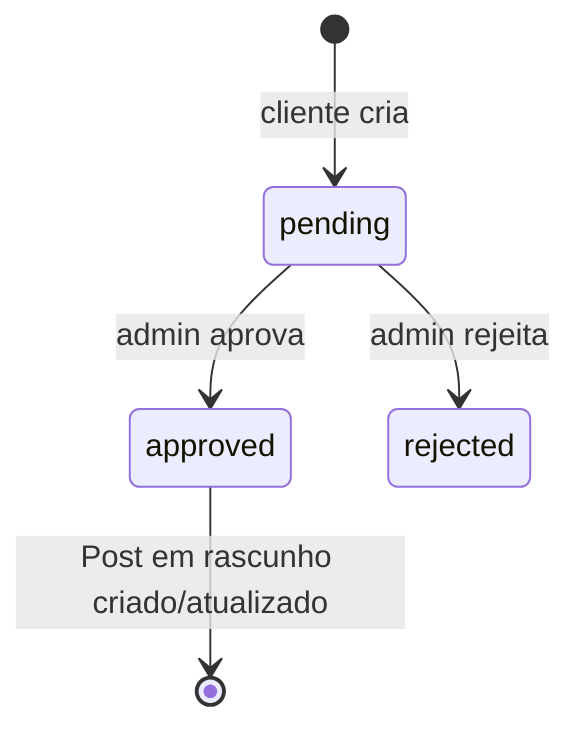

O app `agenda` implementa as **sugestões de pauta**: o cliente (ou um admin, em nome dele) propõe um conteúdo — título, descrição, data, formato e mídias — que passa por aprovação. Aprovada, a sugestão vira um `Post` em rascunho no app `post`.

Endpoints: veja a [Referência de API](/plataforma/api-referencia) (grupo *Agenda*).

## Models principais

| Model | Papel |
|---|---|
| `AgendaSuggestion` | A sugestão: `client`, `title`, `description`, `suggested_date`, `post_format`, `status`, `admin_notes` e o `post` gerado depois da aprovação. |
| `AgendaSuggestionMedia` | Arquivos anexados à sugestão (`related_name='medias'`). O campo `AgendaSuggestion.media` é legado, de arquivo único. |

O serializer expõe `media_urls`, que junta o campo legado e as `medias` em URLs absolutas. É o campo que o front deve consumir.

## Ciclo de vida

| Status | Efeito |
|---|---|
| `pending` | Estado inicial. A criação por um cliente notifica os admins (`notify_admins`). |
| `approved` | `_sync_to_post` cria um `Post` com status `draft` (ou atualiza o já vinculado) e o cliente dono é notificado (`notify`). |
| `rejected` | Não entra na contagem de cota. |

## Regras de negócio

**Quem vê o quê.** Admin (`is_superuser`, `is_staff` ou `role == 'admin'`) vê e edita todas as sugestões, com filtro por `client_id`. Cliente vê só as próprias, e o `client` enviado no payload é sobrescrito pelo cliente do usuário autenticado.

**Validação na criação** (`_validate_suggestion_limits`), só para não-admin:

1. **Calendário editorial.** Se o cliente tem regras ativas de `EditorialCalendar` para o dia da semana da data sugerida, o formato precisa estar entre os permitidos; senão a resposta lista os dias em que o formato é aceito. Sem regra para o dia, qualquer formato passa.
2. **Cota do plano.** Com uma `Subscription` ativa, lê o `PlanMeta` `max_<formato>_month` (slug do nome do formato) e soma, no mês da data sugerida, as sugestões não rejeitadas e os posts que não vieram de sugestão e não estão cancelados. Atingido o limite, recusa.

O mesmo cálculo é exposto em `GET /api/v1/agenda/limits/` para o front avisar antes de enviar o formulário (`is_valid`, `total_used`, `max_allowed`, `remaining`). Para admin, `is_valid` é sempre `true`.

<Warning>
A validação de cota e calendário roda **só na criação**. Editar formato ou data de uma sugestão existente não revalida. Sem assinatura ativa, ou se o cálculo falhar, a criação é permitida.
</Warning>

**Datas aceitas** em `suggested_date`: `YYYY-MM-DD`, ISO datetime, `DD/MM/YYYY`, `YYYY/MM/DD` e `DD-MM-YYYY` (`_parse_suggested_date`).

**Post gerado.** O `Post` criado na aprovação recebe `subject`, `content`, `post_date` e `post_format` da sugestão, com `post_time` fixo em `09:00:00`.

**Antecedência mínima.** O cliente não pode sugerir data anterior ao 2º dia de postagem depois de hoje (`services.py::data_minima_da_sugestao`, pelos dias ativos do calendário; sem calendário, todo dia conta). `GET agenda/minimum-date/` devolve `{min_date, lead_days}`; fora do prazo, criar ou remarcar responde `422` `MINIMUM_LEAD_TIME_REQUIRED`. Equipe e agência não têm o limite.

**Ideia na esteira.** A sugestão aprovada sobrescreve o card do dia (o de mesmo formato; senão, o primeiro) e o deixa pendente e não gerado, para a esteira gerar; sem card no dia, cria um. Cards publicados, em geração, cancelados, com publicação em curso ou já ocupados por outra ideia não são tocados. Recusar ou excluir a ideia depois de aprovada restaura a pauta anterior. Só equipe e agência mudam o `status` da sugestão (`403` para o cliente).

**Pauta com IA.** `POST agenda/format-ai/<id>/` pede ao MiggoAI (workflow `pauta`) que transforme a ideia em `{titulo, tema, formato_id, cta}`, entre os formatos do calendário do cliente. Nada é gravado: a aprovação segue o fluxo normal. Falha da IA responde `502`.

## Integrações

| Com | Como |
|---|---|
| [`post`](/plataforma/apps/post) | Destino da sugestão aprovada (`Post`, `PostFormat`, `PostStatus`). |
| [`editorial-calendar`](/plataforma/apps/editorial-calendar) | Regras de dia e formato usadas na validação. |
| [`subscription`](/plataforma/apps/subscription) | `Subscription` ativa e `PlanMeta` com os limites mensais. |
| [`notification`](/plataforma/apps/notification) | `notify_admins` na criação e `notify` na aprovação. Falha de notificação não afeta a resposta. |

## Onde fica no código

| Caminho | Conteúdo |
|---|---|
| `app/agenda/models.py` | `AgendaSuggestion`, `AgendaSuggestionMedia`. |
| `app/agenda/views.py` | Views e regras: `_validate_suggestion_limits`, `_sync_to_post`, `_parse_suggested_date`. |
| `app/agenda/serializers.py` | `AgendaSuggestionSerializer` (com `media_urls`). |
| `app/agenda/urls.py` | Rotas, montadas em `/api/v1/agenda/`. |
