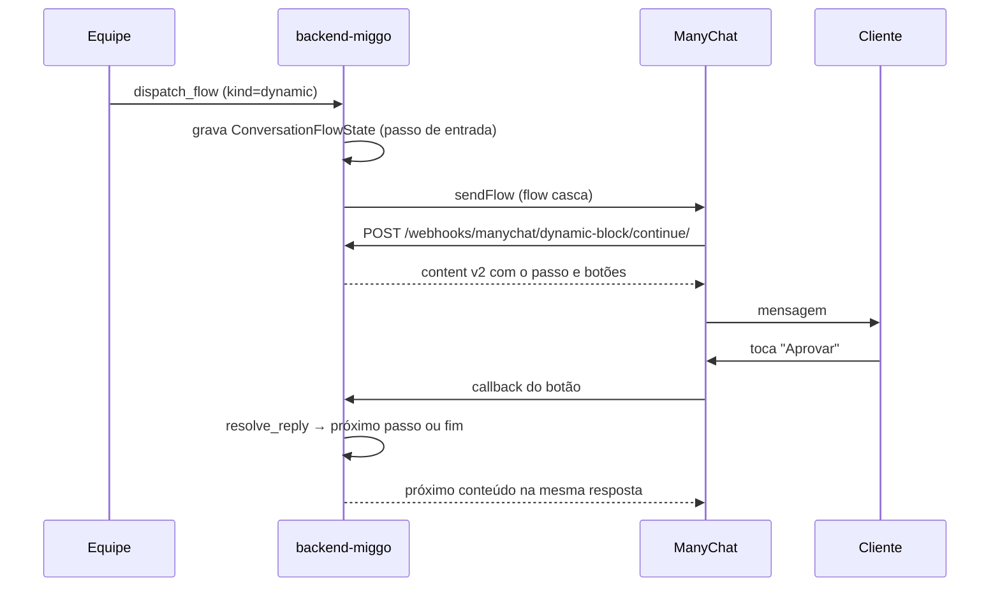

O app `conversation` guarda as duas pontas da conversa de WhatsApp com o cliente: o que chega pelo webhook do ManyChat (`inbound`) e o que a Miggo envia (`outbound`, manual ou automático). Também é dono de um **motor de flows com decisão**, que monta conversas ramificadas ("Aprovar" / "Pedir ajuste") decidindo o próximo passo no backend, não no builder do ManyChat.

<Note>
WhatsApp é **canal de comunicação**, não rede de publicação. Ele aparece como `SocialNetwork` só porque compartilha a tabela de plataformas. Listas de "publicar em" precisam filtrá-lo.
</Note>

Endpoints: veja a [Referência de API](/plataforma/api-referencia) (grupo *Conversas*). Os webhooks do ManyChat estão em [Webhooks](/plataforma/guias/webhooks).

## Models principais

| Model | Papel |
|---|---|
| `Conversation` | Uma thread por subscriber do ManyChat, ligada ao `Client`. Guarda `last_inbound_at`, que define a janela de 24h, e `unread_count`. |
| `Message` | Cada mensagem: `direction` (`inbound`/`outbound`), `kind` (texto, mídia, flow), `source`, `status` e `delivery_status`. |
| `MessageFlow` | Um disparo que a equipe aciona numa conversa. `kind='manychat'` dispara um flow pronto do ManyChat; `kind='dynamic'` monta o conteúdo aqui. |
| `MessageFlowStep` | Um passo de um flow dinâmico: blocos de mensagem, `options` de resposta e o próximo passo de cada uma. |
| `ConversationFlowState` | Em qual passo de qual flow a conversa está. Um por conversa, apagado ao chegar num passo terminal ou ao expirar. |

## Regras de negócio

**Janela de 24h.** `Conversation.is_window_open` é verdadeiro até 24h depois da última mensagem do cliente. Fora dela, `sendContent` (mensagem livre) é recusado; `sendFlow` funciona sempre.

**Entrega.** `status` diz se a Miggo conseguiu disparar; `delivery_status` diz o quanto se sabe que chegou:

| `delivery_status` | Prova |
|---|---|
| `aceito` | O ManyChat aceitou o disparo. Não prova entrega. |
| `rejeitado` | Não saiu (erro, resposta não-success ou janela fechada). |
| `processado` | O flow casca chamou o `/continue/`: rodou no ManyChat. Ainda não é entrega. |
| `confirmado` | O cliente respondeu depois do envio. Única prova real. |

Mensagem parada em `aceito`/`processado` por mais de 24h é tratada como "sem confirmação" (estado derivado, nunca gravado).

<Warning>
O ManyChat responde `200` mesmo quando falha. O veredito está em `response_data['status'] == 'success'`, e é isso que `services.py` confere.
</Warning>

**Origem do flow.** `MessageFlow.flow_ns_key` aceita só nomes de variável de ambiente no formato `*_FLOW_ID`; o valor da env ganha do `flow_ns` gravado. Isso impede que o painel leia um segredo arbitrário do ambiente.

## O motor de flows com decisão

Só um flow do ManyChat **já em andamento** consegue receber de volta o clique num botão. Por isso todo passo com decisão é entregue por um **flow casca**: um flow criado uma vez no ManyChat, com uma Solicitação Externa para `/webhooks/manychat/dynamic-block/continue/`, cujo id fica em `DYNAMIC_FLOW_STARTER_FLOW_ID`. Sem essa variável, nenhum flow dinâmico fica disponível.



`engine.resolve_reply` casa a resposta (número da lista, rótulo ou `keywords`) com as `options` do passo atual:

- opção com `next_step` não terminal → avança o estado;
- opção com `next_step` terminal → entrega o passo e apaga o estado;
- opção com `flow_ns` → apaga o estado e passa a conversa para um flow puro do ManyChat;
- sem casamento → reenvia o passo com o `fallback_text`;
- estado com mais de 24h sem interação → expira na próxima leitura.

Passos podem ter blocos `type='action'`, executados antes da mensagem. O catálogo é **fechado** (`actions.py`) para que conteúdo editável no painel não execute código arbitrário:

| Ação | Efeito |
|---|---|
| `enviar_post_whatsapp` | Envia o post para aprovação no WhatsApp. |
| `aprovar_post` | `Post.status` → `approved`. |
| `pedir_ajuste_post` | `Post.status` → `rejected` com o motivo, e avisa os admins. |
| `avisar_equipe` | Notifica os admins sem falar com o cliente. |

Textos aceitam interpolação `{{nome}}`, `{{primeiro_nome}}`, `{{cliente}}`, `{{telefone}}`, `{{email}}` e custom fields do ManyChat como `{{cf.<nome>}}`.

## Efeitos colaterais e integrações

| Com | Como |
|---|---|
| ManyChat | `sendContent`, `sendFlow` e Dynamic Block. Cada chamada grava um `Integration` de auditoria. |
| [`integration`](/plataforma/apps/integration) | `post_save` de `PlatformIntegration` do WhatsApp cria a `Conversation` do cliente (`signals.py`). |
| [`post`](/plataforma/apps/post) | Ações de aprovação e envio de post. |
| Outros módulos | `services.log_automation` registra na thread disparos feitos fora daqui (ex.: aviso de fim de teste do app `subscription`). |

Resolução do cliente de uma mensagem nova: `PlatformIntegration.profile_id`, depois e-mail, depois os últimos 10 dígitos do telefone.

## Comandos

```bash
# cria conversa para todo cliente com WhatsApp já conectado
python manage.py sync_conversations

# simula o ManyChat contra o backend local (exige MANYCHAT_WEBHOOK_TOKEN)
python manage.py trigger_manychat_webhook --subscriber-id 123 --text "Aprovo"
python manage.py trigger_manychat_webhook --subscriber-id 123 --continue --option "Aprovar"
```

## Onde fica no código

| Caminho | Conteúdo |
|---|---|
| `app/conversation/models.py` | Models e choices de status. |
| `app/conversation/webhooks.py` | `webhook_manychat` e `manychat_dynamic_block_continue`. |
| `app/conversation/engine.py` | Estado da conversa, ramificação e envio pelo flow casca. |
| `app/conversation/flows.py` | Validação de blocos e montagem do `content` v2. |
| `app/conversation/actions.py` | Catálogo de ações. |
| `app/conversation/services.py` | Gravação de mensagem e chamadas ao ManyChat (`dispatch_flow`, `send_content`, `send_flow`). |
