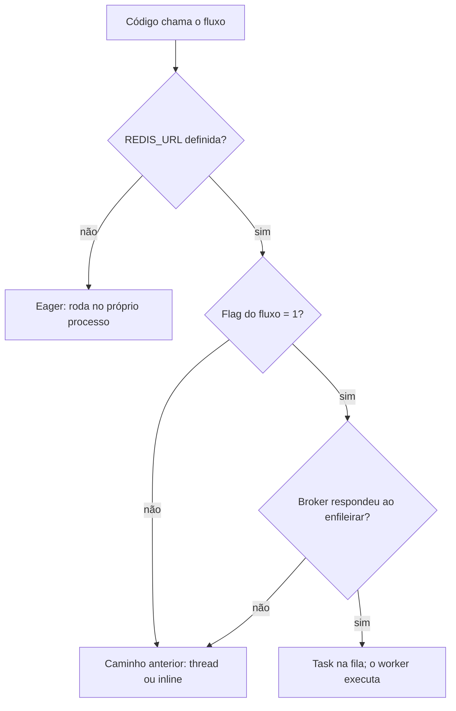

O backend usa **Celery com Redis** para rodar fora do request o que é lento ou depende de serviço externo: análise do onboarding, raspagem, publicação no Zernio, sincronização de cobrança. Tudo vem **desligado por padrão** e é ligado por flag, fluxo a fluxo.

## Como decide entre fila e processo



- **Sem `REDIS_URL`** o Celery roda em modo *eager*: a task executa no processo que a chamou, e nenhum worker é necessário.
- **Com `REDIS_URL`**, cada fluxo ainda exige a própria flag `=1`. Sem ela, segue pelo caminho de antes.
- **Broker fora do ar na hora de enfileirar** também cai no caminho de antes, em vez de perder o trabalho.

## Peças

| Peça | Onde | O que faz |
|---|---|---|
| App Celery | `core/celery.py`, `core/celery_config.py` | Filas `interativo`, `integracoes` e `leve` (padrão `leve`), cada uma com exchange `direct`. Chaves no Redis com prefixo `backend-miggo:` |
| Gatilhos | `core/fila.py` | `fila_ativa()` (há broker de verdade) e uma função por fluxo, cada uma lendo sua flag `*_ASYNC` |
| Tasks | `core/tasks.py`, `app/*/tasks.py` | `core.ping`, `core.rodar_rotina` e as tasks de negócio (`brandkit.*`, `client.atualizar_brand_knowledge`, `media.analisar_midia`, `onboarding.*`, `post.*`, `subscription.executar_sync`) |
| Worker | `docker-entrypoint.sh` com `ROLE=worker` | Consome as três filas |
| Flower | `core/flower_guard.py` | Painel do Celery, no container do web |

### Filas

| Fila | Para quê |
|---|---|
| `interativo` | Trabalho que alguém está esperando na tela: etapas do onboarding, correção de peça de perfil, ingestão de referência |
| `integracoes` | Chamadas a serviços externos: Apify, Zernio, Stripe/Asaas, ManyChat e a maioria das rotinas agendadas |
| `leve` | Trabalho de fundo barato: análise de mídia, resumo da marca, primeira geração |

## Flags por fluxo

| Flag | Fluxo | Fila |
|---|---|---|
| `ONBOARDING_ASYNC` | Análise, estratégia, primeiro post e grid do onboarding | `interativo` |
| `PERFIL_ASYNC` | Correção de peça de perfil (`post.executar_correcao_perfil`) | `interativo` |
| `INGESTAO_ASYNC` | Análise de referência de design | `interativo` |
| `INGESTAO_JOBS_ASYNC` | Transmute por URL e import de site viram `202 {job_id, status}` | `interativo` |
| `APIFY_ASYNC` | Veredito do Instagram, e troca o cache da aplicação para Redis | `integracoes` |
| `APIFY_JOBS_ASYNC` | `instagram-scrape/` vira `202` + job | `integracoes` |
| `MIDIA_ASYNC` | Análise de mídia da galeria | `leve` |
| `ZERNIO_ASYNC` | Publicação por rede e o webhook legado do Zernio | `integracoes` |
| `SYNCJOB_ASYNC` | Sincronização de assinaturas (`SyncJob`) | `integracoes` |
| `MANYCHAT_ASYNC` | Retentativa do flow do código de verificação | `integracoes` |
| `BRANDKNOWLEDGE_ASYNC` | Resumo `brand_knowledge` do cliente | `leve` |
| `<COMMAND>_ASYNC` | Rotina agendada só enfileira (abaixo) | `integracoes` ou `leve` |

<Warning>
  `INGESTAO_JOBS_ASYNC` e `APIFY_JOBS_ASYNC` **mudam o contrato da API**: a resposta passa de `200` para `202` + polling em `GET /api/v1/brandkit/ingestion-job/<id>/`. Ordem de ativação: front que trata o `202`, backend com as migrations do `brandkit`, worker no ar e, por último, a flag.
</Warning>

Cada fluxo tem também `<FLUXO>_TASK_TIME_LIMIT` e `<FLUXO>_TASK_SOFT_TIME_LIMIT` (`ONBOARDING_*`, `INGESTAO_*`, `MIDIA_*`, `ZERNIO_*`, `SYNCJOB_*`, `MANYCHAT_*`, `BRANDKNOWLEDGE_*`, `PERFIL_*`, `ROTINAS_*`). Os valores são validados na carga: limite inválido impede a aplicação de subir. Lista completa em [Variáveis de ambiente](/plataforma/configuracao#celery-redis-e-flower).

## Rotinas que só enfileiram

As rotinas agendadas continuam sendo management commands chamados pelos Schedules do Dokploy, com o mesmo comando e o mesmo cron. Com `<NOME_DO_COMMAND>_ASYNC=1` na env do schedule (ex.: `EXPIRE_TRIALS_ASYNC=1`) **e** fila ativa, o command enfileira `core.rodar_rotina(nome, opcoes)` e sai. Sem isso, roda no processo como sempre. A tabela fica em `core/rotinas.py`.

- **Dry-run nunca enfileira** (`disconnect_inactive_zernio_accounts` sem `--apply`, `send_marketing_emails --dry-run`, `pedir_primeira_geracao --dry-run`).
- **Sem retry** e `acks_late=False`: quem reexecuta é o próximo disparo do schedule. Um advisory lock do Postgres por nome garante uma execução por rotina.
- **Disparo velho é descartado:** cada rotina tem um `expires` (5 min → 10 min; 10 min → 20 min; 15 min → 20 min; horária → 30 min; 6 h → 3 h; diária → 6 h).
- Limites: `ROTINAS_TASK_TIME_LIMIT` (1800 s) e `ROTINAS_TASK_SOFT_TIME_LIMIT` (1700 s).
- O log do schedule mostra só `[rotina] <nome> enfileirada na fila '<fila>'.`; o resumo da execução vai para o log do worker.

Rotinas cobertas: `notify_trial_ending`, `expire_trials`, `check_invoices`, `check_subscriptions`, `sync_stripe_billing`, `sync_asaas_billing`, `scan_gateway_orphans`, `disconnect_inactive_zernio_accounts`, `reconcile_zernio_posts`, `send_grid_approval_reminders`, `send_marketing_emails`, `generate_pending_grids` e `pedir_primeira_geracao`. `analyze_media_library` e `sync_jira_ticket_status` rodam sempre no processo.

## Worker

Web e worker usam **a mesma imagem**; o serviço de worker no Dokploy só muda a env para `ROLE=worker`. O entrypoint então sobe:

```bash
celery -A core worker -Q interativo,integracoes,leve -l info -E \
  --concurrency ${CELERY_WORKER_CONCURRENCY:-2} -n backend@%h \
  --max-tasks-per-child 50 --max-memory-per-child 700000
```

O worker não roda `migrate`, `collectstatic` nem Flower. `ROLE` ausente ou `web` sobe a API; outro valor recusa subir (`exit 64`). Ver [Deploy](/plataforma/deploy).

## Flower

Com `ROLE=web`, o entrypoint sobe o Flower em segundo plano (porta `FLOWER_PORT`, padrão `5555`) e o web segue como processo principal.

- Sem `FLOWER_BASIC_AUTH` válida (`usuario:senha`, senha com 12 caracteres ou mais), o Flower **não sobe** e o web segue normalmente; o log mostra a recusa.
- `FLOWER_ENABLED=0` desliga o Flower no container. Use no serviço de worker se ele não estiver com `ROLE=worker`.
- `CELERY_BROKER_POOL_LIMIT` muito baixo trava o *inspect* do Flower.

## Rodar um worker local

<Steps>
  <Step title="Subir um Redis">
    ```bash
    docker run --rm -p 6379:6379 redis:7
    ```
  </Step>
  <Step title="Ligar a fila no .env">
    ```bash
    REDIS_URL=redis://localhost:6379
    ONBOARDING_ASYNC=1        # flag do fluxo que for testar
    ```
  </Step>
  <Step title="Subir o worker">
    ```bash
    celery -A core worker -Q interativo,integracoes,leve -l info
    ```
  </Step>
  <Step title="Conferir">
    ```bash
    python manage.py celery_ping
    ```
    Imprime `OK [broker] {"pong": true, ...}` com o worker no ar e `FALHA (<tipo>)` sem ele. Nunca imprime a URL do Redis.
  </Step>
</Steps>

No Windows, o pool padrão do Celery não funciona: acrescente `--pool=solo` ao comando do worker.

## Relacionados

<Columns cols={2}>
  <Card title="Tarefas agendadas" icon="clock" href="/plataforma/tarefas-agendadas">
    Quais rotinas existem e quando rodam.
  </Card>
  <Card title="Deploy" icon="cloud-upload" href="/plataforma/deploy">
    Serviços web e worker no Dokploy.
  </Card>
</Columns>
