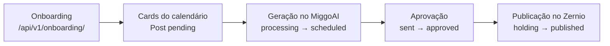

Este guia segue um cliente novo até o primeiro post publicado, com os endpoints, os status e as rotinas de cada etapa. Para o mapa geral dos serviços, veja [Fluxos principais](/arquitetura/fluxos).



## 1. Onboarding

O cliente passa pelas etapas de `/api/v1/onboarding/`, na ordem que o web app conduz. O estado fica numa `OnboardingSession`, e `GET state/` diz onde ele parou.

| Etapa | Endpoints | O que acontece |
|---|---|---|
| Cadastro e WhatsApp | `signup/`, `verify/` | Cria o usuário e o `Client`; confirma o WhatsApp por código enviado pelo ManyChat |
| Fonte da marca | `validate-profile/`, `brand-source/`, `analysis-status/` | Lê Instagram (Apify) e site; a análise roda em segundo plano e o front acompanha pelo status |
| Revisão e identidade | `review/`, `identity/*`, `logo/`, `photos/` | Confirma os dados, o logo e a paleta do brandkit |
| Plano | `plan/` | Escolhe o plano; o teste grátis começa aqui |
| Estratégia | `strategy/generate/`, `strategy/approve/` | Gera e aprova a estratégia de conteúdo |
| Calendário | `calendar/`, `calendar/approve/` | Define dias, formatos e objetivos do `EditorialCalendar` |
| Grid | `grid/styles/`, `grid/`, `grid/approve/` | Escolhe o estilo; o mosaico 3x3 é gerado no MiggoAI e aprovado pelo cliente |
| Primeiro conteúdo e conclusão | `first-content/`, `first-content/approve/`, `complete/` | Mostra o primeiro post e encerra o onboarding |

`POST resume/` retoma a esteira na etapa pendente. Regras de cada etapa em [Onboarding](/plataforma/apps/onboarding).

<Note>
  O grid do onboarding é gerado pelo MiggoAI em `POST /api/generations/grid/`, com `idempotency_key`: repetir a chamada não gera nem cobra outra imagem. Se a geração demora, o MiggoAI responde `202` e o backend acompanha pela chave por até `GRID_ASYNC_ESPERA_MAXIMA` segundos. Ver [Gerar conteúdo no MiggoAI](/miggoai/guias/gerar-conteudo).
</Note>

## 2. Cards do calendário

Cada dia de postagem do calendário vira um `Post` vazio, com status `pending`: é o "card" que a geração vai preencher.

- `POST /api/v1/post/create-posts/` cria os cards das próximas duas semanas a partir das regras ativas do `EditorialCalendar`, sem duplicar o que já existe.
- A conclusão do onboarding registra um **pedido de geração**. A rotina `pedir_primeira_geracao` é a rede de segurança: garante o pedido para quem está em teste e ainda não tem conteúdo, e liga `Client.miggoai_workflow_enabled`.

## 3. Geração no MiggoAI

O MiggoAI preenche os cards. Ele lê e grava na Plataforma usando a `Api-Key` de serviço ([Autenticação](/plataforma/autenticacao)).

| Status do `Post` | Quem muda | Significado |
|---|---|---|
| `pending` | Plataforma | Card criado, sem conteúdo |
| `processing` | MiggoAI | Geração em andamento |
| `scheduled` | MiggoAI | Conteúdo entregue: título, imagem, legenda e hashtags gravados no card |

Falha em qualquer passo devolve o card para `pending`.

Três caminhos disparam a geração:

| Caminho | Como |
|---|---|
| Rodada diária | Rotina do MiggoAI (`generate_daily_contents`), que atende os clientes com `miggoai_workflow_enabled` e direito de receber conteúdo |
| Gerar agora | `POST /api/v1/client/miggoai-generate-now/<id>/` grava o pedido; o backend chama `POST /api/generations/gerar-agora/` no MiggoAI |
| Regerar uma parte | `POST /api/v1/post/miggoai/regenerate/` (título, imagem, legenda ou hashtags, com instrução opcional) e `GET .../regenerate/status/` para acompanhar |

Os disparos ao MiggoAI respondem `202` com `status` `aceito` (a rodada começou) ou `na_fila` (já havia uma em andamento; o pedido fica para a próxima). Decida pelo campo `status`, não pelo código HTTP.

## 4. Aprovação

O conteúdo vai para o cliente aprovar, no app ou no WhatsApp.

| Status | Significado |
|---|---|
| `sent` | Enviado para o cliente aprovar |
| `in_review` | O cliente pediu ajuste movendo o post no app (movido pela equipe, é envio para revisão) |
| `rejected` | O cliente reprovou com motivo (`correction_description`), pelo app ou pela ação `pedir_ajuste_post` do WhatsApp |
| `approved` | Aprovado |

- **Pelo WhatsApp:** `POST /api/v1/post/send-post-whatsapp/` dispara o flow de aprovação no ManyChat e leva o post a `sent` depois do envio. O flow depende da rede: `CONTENT_APPROVATION_CONNECTED_FLOW_ID` quando a rede do post está conectada (a Miggo publica) e `CONTENT_APPROVATION_FLOW_ID` quando não está (o cliente publica). As respostas do cliente voltam pelo webhook do ManyChat ([Webhooks](/plataforma/guias/webhooks#manychat)).
- **Envio agendado:** `POST /api/v1/post/schedule-review/` agenda o envio para uma data e hora; a rotina `send_scheduled_reviews` dispara quando a hora chega. Hora sem fuso é lida como `America/Sao_Paulo`.
- **No app:** o cliente só enxerga os posts em `sent`, `in_review`, `approved` e `published`. Os status internos (`pending`, `processing`, `scheduled`, `error`) nunca aparecem para ele.

Cada mudança de status gera um `PostStatusEvent` e, conforme a transição, uma notificação (por exemplo, `in_review` pedido pelo cliente avisa a equipe).

## 5. Publicação

```bash
curl -X POST https://api.miggomkt.com.br/api/v1/post/publish/ \
  -H "Authorization: Bearer $ACCESS" \
  -H "Content-Type: application/json" \
  -d '{"post_id": 123, "publish": "publish"}'
```

| `publish` | Efeito |
|---|---|
| `publish` | Publica agora |
| `schedule` | Agenda no Zernio para `post_date` + `post_time` (horário de São Paulo) |
| `cancel` | Cancela |

O post precisa de formato e de mídia vinculada, e o cliente precisa ter direito de publicar (sem isso, `402`). A view valida e responde na hora; o envio ao Zernio (upload das mídias e `POST /v1/posts`) roda em segundo plano, com uma `PostPublication` por rede.

| Status | Onde | Significado |
|---|---|---|
| `holding` | `Post` | Enviado ao Zernio, aguardando confirmação da publicação |
| `scheduled` | `Post` e `PostPublication` | Agendado no Zernio |
| `sending` | `PostPublication` | Enviado, desfecho ainda desconhecido (a chamada estourou o tempo) |
| `published` | `Post` e `PostPublication` | Publicado, com `permalink` e `published_at` |
| `failed` | `PostPublication` | A rede recusou de verdade |

Quem fecha o desfecho, do mais rápido ao mais lento:

1. O webhook `/webhooks/zernio/status/`, quando o Zernio avisa.
2. O botão "Verificar status" do web app (`POST /api/v1/post/publication/<id>/check-status/`).
3. A rotina `reconcile_zernio_posts`, que consulta o Zernio sobre as publicações paradas.

<Note>
  Se o cliente não tem a rede principal do formato conectada, mas tem WhatsApp, a Plataforma não publica: envia ao cliente a mensagem de que ele pode postar e marca o post como `approved`.
</Note>

## Onde investigar quando algo para

| Sintoma | Primeiro lugar |
|---|---|
| Card fica em `pending` | `Client.miggoai_workflow_enabled`, direito de receber conteúdo e o log do MiggoAI; chamadas na tabela `Integration` |
| Grid do onboarding não chega | Status da sessão (`GET /api/v1/onboarding/state/`) e a rotina `generate_pending_grids` |
| Aprovação não chega ao WhatsApp | Integração WhatsApp ativa do cliente, flow configurado e `Integration` |
| Post preso em "Enviando" | `PostPublication` em `sending`; rode `reconcile_zernio_posts` |

## Relacionados

<Columns cols={2}>
  <Card title="Post" icon="file-text" href="/plataforma/apps/post">
    Modelos e regras do app de posts.
  </Card>
  <Card title="Gerar conteúdo no MiggoAI" icon="sparkles" href="/miggoai/guias/gerar-conteudo">
    O lado do serviço de IA.
  </Card>
</Columns>
