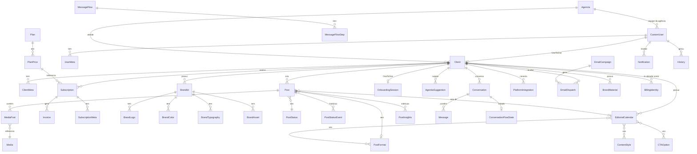

Visão de conjunto dos models do `backend-miggo`. Campos, regras e ciclo de vida de cada model ficam na página do app; os schemas expostos pela API estão na [Referência de API](/plataforma/api-referencia). Todos os ids são `BigAutoField` (`DEFAULT_AUTO_FIELD`).

## Entidades centrais

## Models por app

| App | Models principais | Página |
|---|---|---|
| `account` | `CustomUser`, `UserMeta`, `UsuarioModulo`, `SupportConversation`, `SupportMessage`, `SupportTicket` | [Contas e usuários](/plataforma/apps/account) |
| `agencia` | `Agencia`, `AssinaturaAgencia`, `DominioAgencia`, `MarcaAgencia` | [Agências](/plataforma/apps/agencia) |
| `client` | `Client`, `ClientMeta`, `Niche`, `ClientSignaturePreference`, `ClientMediaPreference`, `BrandMaterial` | [Clientes](/plataforma/apps/client) |
| `onboarding` | `OnboardingSession` | [Onboarding](/plataforma/apps/onboarding) |
| `brandkit` | `Brandkit`, `BrandLogo`, `BrandColor`, `BrandTypography`, `BrandAsset`, `SocialNetworkGrid`, `DesignReference`, `CopyReference`, `IngestionJob`, `ReferenceImportJob`, `ReferenceImportImagem` | [Brandkit](/plataforma/apps/brandkit) |
| `post` | `Post`, `PostStatus`, `PostFormat`, `SocialNetwork`, `PostStatusEvent`, `MediaPost`, `PlatformIntegration`, `PlatformProfileConfig`, `ProfileCorrectionJob`, `PostMetadata`, `PostPublication`, `ScheduledReview`, `PostInsights`, `PostInsightsSnapshot` | [Posts](/plataforma/apps/post) |
| `editorial_calendar` | `EditorialCalendar`, `ContentStyle`, `CTACategory`, `CTAOption`, `FormatStyleRule` | [Calendário editorial](/plataforma/apps/editorial-calendar) |
| `media` | `Media`, `StockPhoto`, `StockPhotoUsage` | [Mídias](/plataforma/apps/media) |
| `agenda` | `AgendaSuggestion`, `AgendaSuggestionMedia` | [Sugestões de pauta](/plataforma/apps/agenda) |
| `subscription` | `Plan`, `PlanPrice`, `PlanFeature`, `PlanMeta`, `Subscription`, `SubscriptionMeta`, `Invoice`, `BillingIdentity`, `OrphanCharge`, `StripeEvent`, `AsaasEvent`, `SyncJob` | [Assinaturas e cobrança](/plataforma/apps/subscription) |
| `benefits` | `Benefit` | [Benefícios de parceiros](/plataforma/apps/benefits) |
| `conversation` | `Conversation`, `Message`, `MessageFlow`, `MessageFlowStep`, `ConversationFlowState` | [Conversas de WhatsApp](/plataforma/apps/conversation) |
| `emailmarketing` | `EmailCampaign`, `EmailSegment`, `EmailDispatch`, `EmailAsset`, `EmailMarketingSettings` | [E-mail marketing](/plataforma/apps/emailmarketing) |
| `notification` | `Notification` | [Notificações in-app](/plataforma/apps/notification) |
| `history` | `History` | [Histórico e relatórios](/plataforma/apps/history) |
| `integration` | `Integration` | [Log de integrações](/plataforma/apps/integration) |

O app `webhooks` não define models: grava nos models de `subscription`, `post` e `conversation`. Veja [Webhooks](/plataforma/guias/webhooks).

## Convenções

- **Tabelas chave/valor** (`UserMeta`, `ClientMeta`, `PlanMeta`, `SubscriptionMeta`, `PostMetadata`) guardam atributos opcionais sem migration. Em `SubscriptionMeta`, o par `(subscription, key)` é único.
- **Catálogos** (`SocialNetwork`, `PostFormat`, `PostStatus`, `ContentStyle`, `CTACategory`) são dados cadastrados, não choices. Código que compara por nome (`status__name='draft'`) depende do valor cadastrado.
- **Logs** têm papéis separados: `History` (ações de clientes), `PostStatusEvent` (status de post), `Integration` (chamadas externas), `StripeEvent`/`AsaasEvent` (idempotência de webhook).
- Toda alteração de model exige migration (`python manage.py makemigrations` + `migrate`).
