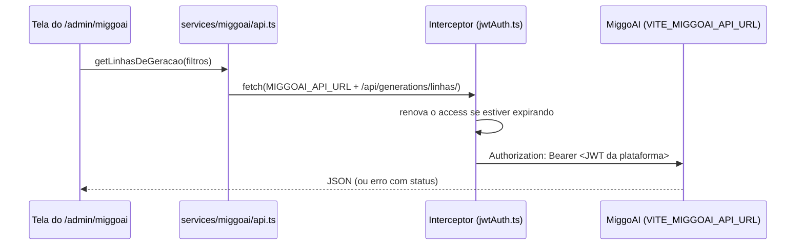

O painel de IA é a interface de operação do MiggoAI. Ele vive no `frontend-miggo`, dentro da área `/admin`, em `src/pages/Admin/MiggoAI/`. A interface do MiggoAI é este painel: as telas chamam a API dele direto do navegador.

## Quem acessa

| Camada | Regra |
|---|---|
| Rota | As rotas `/admin/miggoai/*` ficam dentro do `ManagementRoute`: entra a equipe Miggo (admin e gestor). Não há `ModuloRoute` nelas. |
| Menu | Os itens do grupo "MiggoAI" no menu lateral exigem o módulo `miggoai`; "Modelos" aparece só para `is_superuser`. |
| MiggoAI | Aceita o JWT da plataforma quando o claim `is_management` é `true`; fora disso responde `403`. Não confere o módulo `miggoai`. |
| Escrita restrita | Alterar modelos, preços e cotações exige superusuário. `useIsSuperuser()` (`MiggoAI/superuser.ts`) só decide o que a tela mostra; o MiggoAI recusa a escrita com `403`. |

<Warning>
O MiggoAI não confere o módulo `miggoai`: o módulo só esconde o menu. Quem tem `is_management` usa o painel pela URL.
</Warning>

## Como o painel fala com o MiggoAI

| Peça | Arquivo | Papel |
|---|---|---|
| Base URL | `src/services/miggoai/config.ts` | `VITE_MIGGOAI_API_URL` (default `http://localhost:8010`). `isMiggoaiApiUrl` marca essa origem com caminho `/api/` como API. |
| Token | `src/services/jwtAuth.ts` | O interceptor anexa o Bearer da plataforma **só** a essa origem, com o mesmo refresh e retry no `401` das chamadas à Plataforma. |
| Cliente tipado | `src/services/miggoai/api.ts` e `types.ts` | Uma função por endpoint. Erros viram `MiggoaiApiError` (`status`, `corpo`). `403` vira "Seu usuário não tem acesso ao MiggoAI."; falha de rede ou CORS vira status `0` com mensagem amigável. |
| Rotas | `src/pages/Admin/MiggoAI/routes.ts` | `miggoaiPaths` monta todos os caminhos do painel. Não escreva `/admin/miggoai/...` à mão. |

O token é RS256 com audiência `miggoai`. Como ele é emitido e validado está em [Autenticação do MiggoAI](/miggoai/autenticacao). Os endpoints estão na [Referência de API do MiggoAI](/miggoai/api-referencia).

## Telas

| Rota | Componente | O que faz | Endpoints do MiggoAI |
|---|---|---|---|
| `/admin/miggoai` | `Overview` | Visão geral por período: gerações, falhas e custo. Cada número abre a lista filtrada. | `GET /api/generations/resumo/`, `GET /api/custos/dashboard/` |
| `/admin/miggoai/runs` | `Runs` | Execuções (post completo) e gerações avulsas, paginadas no servidor. Filtros `client`, `post`, `environment`, `status`. Atualiza sozinha enquanto a aba está visível. | `GET /api/generations/linhas/`, `GET /api/clients/` |
| `/admin/miggoai/runs/:tipo/:id` | `RunDetail` | Detalhe de uma execução (`tipo` = `run`) ou geração (`generation`). Abre no resultado como a peça vai sair; a aba Rastreamento (`?tab=trace&span=<id>`) mostra a árvore de etapas, entrada e saída de cada uma (`components/trace/*`). | `GET /api/generations/execucoes/{id}/`, `GET /api/generations/{id}/` |
| `/admin/miggoai/generate/:clientId/:postId` | `Generate` | Gera o conteúdo de um card: uma etapa (título, imagem, legenda, hashtags) ou o post completo. Mostra o briefing, as variáveis e o preview do prompt. | `GET /api/generations/context/`, `POST /api/generations/{test\|production}/`, `POST /api/generations/{test\|production}/complete/`, `PUT /api/clients/{id}/variables/` |
| `/admin/miggoai/prompts` | `Prompts` | Prompt Studio: lista por workflow, ativar e desativar (com confirmação). | `GET /api/prompts/`, `GET /api/prompts/workflows/`, `POST /api/prompts/{id}/activate/` e `deactivate/` |
| `/admin/miggoai/prompts/:id` | `PromptEditor` | Edita o template e as variáveis. O preview mostra o prompt inteiro que vai para a IA (texto editável + a parte fixa do sistema, travada) com dados de um cliente e card reais. Histórico de versões; restaurar cria uma versão nova. | `GET/PUT /api/prompts/{id}/`, `POST /api/prompts/{id}/preview/`, `GET /api/prompts/{id}/versions/`, `POST .../versions/{v}/restore/`, `/api/prompts/{id}/variables/` |
| `/admin/miggoai/clients/:id` | `ClientMiggoAI` | MiggoAI de um cliente: workflow ligado ou desligado, cards por data com a última geração, peças de perfil (banner, destaques, grid, bio) e variáveis salvas. Entra pelo menu da linha em `/admin/clients` (o id do cliente é o mesmo nos dois serviços). | `GET /api/clients/{id}/`, `GET /api/posts/?client_id=`, `GET /api/generations/linhas/`, `/api/clients/{id}/variables/` |
| `/admin/miggoai/usage` | `Usage` | Uso e custos, com abas na URL: Resumo (sem `?tab`), Chamadas (`calls`), Preços (`prices`), Câmbio (`exchange`). Custo medido e estimado andam separados. | `GET /api/custos/dashboard/`, `GET /api/custos/chamadas/`, `/api/custos/precos/`, `/api/custos/cotacoes/` |
| `/admin/miggoai/models` | `Models` | Modelo e parâmetros de cada workflow. Escrita só para superusuário; modelo sem preço cadastrado gera aviso (as chamadas entram com custo zero até o preço existir). | `GET /api/prompts/workflows/?todos=1`, `PATCH /api/prompts/workflows/{id}/` |

## Teste e produção

Toda geração escolhe um ambiente no topo da tela (`SeletorDeAmbiente`, em `components/EnvironmentSwitch.tsx`):

| Ambiente | Endpoint | Efeito |
|---|---|---|
| Teste (`TEST`) | `/api/generations/test/...` | Gera e registra a execução, **sem** mexer no card. |
| Produção (`PRODUCTION`) | `/api/generations/production/...` | Grava o resultado no card do cliente e substitui o conteúdo atual. |

Em produção a tela pinta uma faixa de alerta (`FaixaDeProducao`), o botão muda de cor (`BotaoExecutar`) e toda execução passa por `ConfirmarProducaoModal`, que lista o que será sobrescrito ("o título", "a legenda"...).

<Warning>
O ambiente aqui é do **MiggoAI** (gerar em teste ou gravar no card), não da infraestrutura. Cada deploy do web app fala com o MiggoAI configurado em `VITE_MIGGOAI_API_URL` no seu build; os dois modos usam esse mesmo serviço. Veja [Ambientes](/arquitetura/ambientes).
</Warning>

## Variáveis e "Salvar como padrão"

Na tela `Generate`, a variável editada vale **só para aquela execução**. "Salvar como padrão do cliente" é uma ação separada (`PUT /api/clients/{id}/variables/`) e passa a valer nas próximas gerações. A saída de uma etapa usada como entrada da próxima é do post e nunca entra no padrão. Para apagar um padrão, `DELETE /api/clients/{id}/variables/{chave}/` (pela tela do cliente).

## Erros que a tela trata

| Status | O que significa | O que a tela faz |
|---|---|---|
| `0` | Rede fora, MiggoAI parado ou CORS | "Não foi possível falar com o MiggoAI." |
| `403` | Usuário fora da gestão, ou escrita sem superusuário | "Seu usuário não tem acesso ao MiggoAI." |
| `502` | A IA falhou na geração | Mostra a(s) geração(ões) com falha que vêm no corpo. |
| Outros | Erro do MiggoAI | Mostra o `error` ou `detail` do corpo. |

## Fora do painel

Algumas ações de IA moram em telas da Plataforma e passam pela API dela, não pelo MiggoAI direto:

- **Ligar ou desligar o agente MiggoAI de um cliente** e **gerar agora**: modal de predefinições do cliente em `/admin/clients` (`PUT /api/v1/client/miggoai-workflow/{id}/` com `{ enabled }` e `POST /api/v1/client/miggoai-generate-now/{id}/`). Se o MiggoAI não responder ao disparo, o pedido fica na fila e é atendido em até 15 minutos.
- **Pedir outra versão de um item do card**: modal de edição do post no Kanban de conteúdos.

Veja [Ciclo do conteúdo](/plataforma/guias/ciclo-do-conteudo) e [Gerar conteúdo no MiggoAI](/miggoai/guias/gerar-conteudo).
